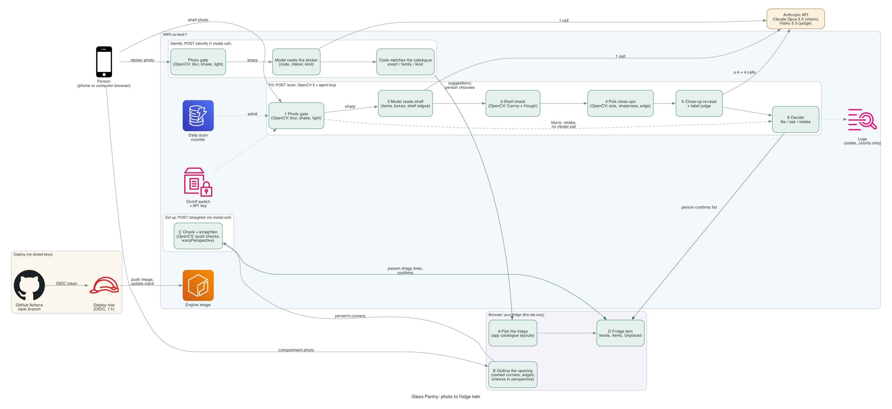

# Glass Pantry (OpenCV AI Competition 2026)

A fridge you can open on your phone, kept true by photos. A web prototype of the Glass Pantry workflow: find your
fridge from its model sticker, trace each compartment over a photo, then photograph each shelf. A vision-language
model (Claude) lists what it sees. OpenCV 5 gates the photo, checks the model's shelf lines against real edges,
straightens traced openings, and selects small labels for a re-read from the uploaded image (the browser sends at
most 3024 px, cut to the shelf the person marks). The engine recommends **file**, **ask** or **retake**; a person
confirms before anything is kept. The fridge lives in the browser tab, drawn in 2D and 3D.

When a shelf is photographed again, **What changed?** (experimental; it failed its pre-set bar, see the report)
lines the new photo up with the last one using OpenCV 5's learned matching (ALIKED + LightGlue) and marks only what
may have changed for a second look.

Pages: `/` the front page, `/fridge` the fridge, `/shelf` a single-shelf check with a recorded example.



## Run it

```
uv sync                 # Python 3.12; pinned: opencv-contrib-python-headless 5.0.0.93, numpy 2.3.4 (uv.lock)
uv run pytest           # generated images and a fake model API only: no photos, no paid calls
```

Real model runs need an Anthropic API key in `.env.local` (`ANTHROPIC_API_KEY=...`, git-ignored):

```
uv run python tools/run_dev.py OUT_DIR photo.jpg --zoom     # result JSON, crops, overlay picture
uv run python tools/serve_local.py --live                   # the web page on http://127.0.0.1:8765
```

## Deploy (AWS)

`.github/workflows/deploy.yml` tests, builds the Lambda container (x86_64) with SAM, and deploys the stack
`glass-pantry-opencv` in us-east-1 on pushes to `main` that change code (documentation-only pushes do not deploy)
or on manual dispatch. It signs in with GitHub OIDC (no stored keys) to a
role meant for this stack's own resources, then smoke-tests the endpoint and runs four probes that the role is
refused elsewhere. The owner creates the execution role, the log group, the ECR repository, the upload bucket and the
call-counter table once (`template.yaml` names them).

Guards on the live endpoint (all server-side): an owner on/off switch in Parameter Store, a shared daily scan cap
(atomic DynamoDB counter, fails closed), upload size and pixel limits, a time budget for every model call, and
logs that hold codes and counts only.

## Code

| Path | Does |
|---|---|
| `verifier/frames.py` | one canonical 1568 px image for every check and the model; the original kept for close-ups |
| `verifier/gate.py` | photo gate: blur, shake, dark, blown-out (no model call on a bad photo) |
| `verifier/prompt.py` | the Glass Pantry app's scan prompt, frozen with a hash |
| `verifier/claude.py` | Messages API calls, answer parsing and validation, the label judge |
| `verifier/planes.py` | shelf lines from the model checked against real horizontal edges (Canny + probabilistic Hough) |
| `verifier/zoom.py` | the zoom pass: OpenCV selects, crops from the original, the model re-reads, the result is reconciled |
| `verifier/decide.py` | evidence → file / ask / retake |
| `verifier/scan.py` | one photo through the loop, with a timed trace of every step |
| `verifier/change.py`, `verifier/rescan.py` | What changed? (experimental): OpenCV 5 ALIKED + LightGlue alignment, per-item outcomes, new regions, `POST /rescan` |
| `verifier/identify.py` | matches the model's sticker reading to the catalogue (exact, family, kind) |
| `verifier/opening.py` | outline checks and straightening (`warpPerspective`); suggestions built but off |
| `service/handler.py` | the Lambda handler: pages, health, recorded example, scan, identify, straighten |
| `web/fridge.html`, `web/twin.js` | the fridge page: pick, trace, fill; the browser twin and its rules |
| `web/scene.js`, `web/twin3d.js` | the schematic 3D view (pure geometry; three.js drawing) |
| `web/home.html` | the front page (`/`): the idea, the steps, the measured results |
| `web/index.html` | the single-shelf check (`/shelf`): upload, overlays, the list to confirm |
| `tools/` | local runs, annotation of results, the evaluation diagnostic |

Docs: [architecture](docs/architecture/), [report (draft)](docs/report.md), [where the code came from](docs/provenance.md).
