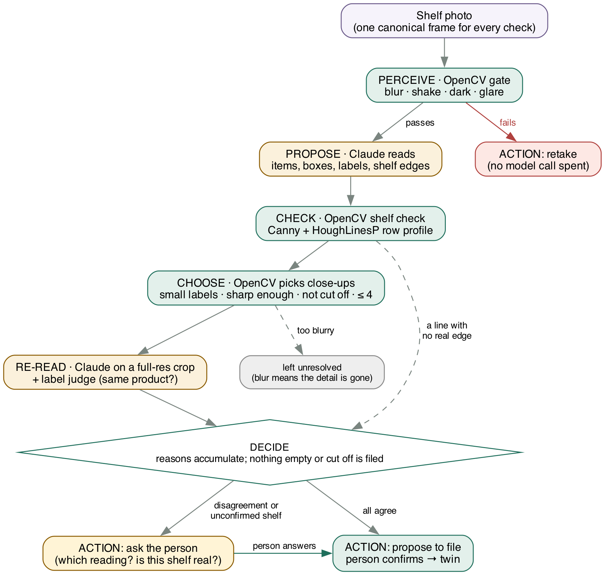
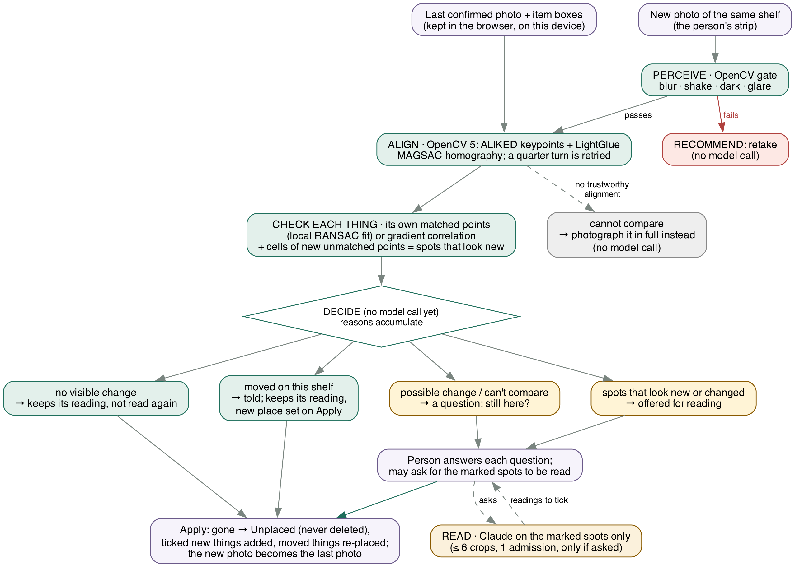

# Glass Pantry Vision Lab: technical report (2026-10-25; §6 comparison added 10/27)

The lab is where we test OpenCV before it goes into the Glass Pantry app, the fridge app we are building (an early
build, in private testing). The lab is not the app.

> Development observations and held-out results are kept apart below. The held-out zoom results were measured with
> count re-reads on; the current label-only configuration has not been evaluated on a fresh held-out set. Numbers
> marked [dev] come from photos used during development; they show behaviour, not accuracy.

## 1. Problem
People forget what is in their fridge. Typing an inventory is tedious, so a phone photo is the natural input. A
vision-language model can list what a shelf photo shows, but one reading can hold plausible wrong names: a model that
cannot read a small label may still write a product name. On our development photos a milk carton was named
"1회용 간장" in one run and "1등급 계란" in the next.

The lab puts targeted checks and re-reads around the model. A person still confirms the list, as they would after a
plain reading; the aim is fewer silent errors, not automatic filing.

## 2. Users
Households keeping track of food, Korean kitchens first (a label does not always say what is inside a reused jar).
The Glass Pantry app is the mobile app we are building for this: an early build in private (TestFlight) testing, not
released. This entry is a separate web prototype that follows the app's workflow. It reuses the app's frozen scan
prompt and an export of its appliance catalogue. Its OpenCV verification loop is not in the phone app, and we do not
claim identical results. The lab is a prototype: user benefit and usability have not been measured.

## 3. What it does
The page follows the app's steps (docs/pipeline.md): pick the fridge, trace each compartment over a photo, fill each
level (a shelf, drawer or door bin) from its own photo. A person confirms every layout and every list. The fridge,
and the last photo of each shelf, stay in this browser on this device (local storage), never on the server; we call
this stored fridge the twin. One tab writes at a time (Web Locks; another tab opens read-only), and a Forget button
removes both; a browser without Web Locks keeps the fridge in that tab only. The lab supports catalogue appliances;
cupboards, pantries and nested containers are future work.

Two words recur below. The model is Claude, the vision-language model that reads photos. An admission is one count
against the shared daily cap on model calls (§5).

**Picking the fridge (one model call).** The person photographs the model sticker or the fridge. OpenCV's photo gate
runs first: a blurry or shaken photo is sent back with the reason, before any model call or admission (AWS processing
still runs). The gate's brightness and glare limits were set on shelf photos and would refuse a clean white sticker,
so they are not applied here. Claude reads the model number as printed, the maker and the fridge's kind; it never
picks a catalogue row. Plain code matches the reading: the exact model number; else a sibling number of the same
maker (a shared 7-character prefix); else the generic layout of that kind and the library fridges of that kind. A
maker conflict blocks exact and family matches when both makers are among the supported Samsung, LG and Winia names;
other makers are not recognised by that filter. The kind may come from sticker text or from a matched catalogue
candidate (including a family match). An answer that is not one complete JSON object (one code fence allowed), or
was cut off, suggests nothing. A suggestion does not verify the appliance's actual interior; the person chooses, then
confirms with the same button as picking from the list.

**Tracing a compartment (no model call).** Two steps on the same photo. Step 1, outline the opening: a see-through
shape with named corners (top-left …) and edges (top edge, left wall …); the person drags a corner or a whole edge
onto the opening. OpenCV checks the quadrilateral (convex, ordered, area ≥ 15%, corner angles 55-125°, opposite sides
within 2.5×) and straightens the opening plane with `getPerspectiveTransform` + `warpPerspective`. Step 2, match the
shelves and drawers: the catalogue's levels appear inside the outline in perspective (the same homography, computed
in the browser), named as they will be saved; the person drags, adds or removes lines and confirms. We also built
OpenCV suggestions for the corners (largest valid convex quadrilateral) and snap edges (Canny + Hough row profile).
Both failed their pre-set bar on the test photos and are switched off (§6), so OpenCV draws nothing of its own. A
removed shelf's things move to Unplaced; nothing is deleted. A photo whose opening cannot be framed may be traced
unstraightened and is labelled unverified; even then an outline the lines cannot be drawn through (crossed corners, a
corner on the diagonal, under 5% of the photo) is refused.

**Seeing the fridge in 3D (no model call).** The 3D view (three.js) draws the live compartments' shelves and drawers
and their things. A thing whose reading names a row of the app's item library (52 baked models, matched by the app's
own rule: the longest match word wins) is drawn with that item model, starting from its catalogue dimensions and
scaled down uniformly to the renderer's limits (90% of the level's height, half its width, its depth). Any other
thing is a basic box or cylinder sized by its box in the shelf photo. It wears its own photo crop on the front when a
matching retained crop for that item and shelf is available and decodes (the shelf's latest kept photo lists it);
otherwise it is plain. An item model that fails to load leaves its placeholder. The item boxes guide horizontal
position; depth comes from where the thing's foot stands in the photo and is approximate, not reconstructed or
measured. Older rows without placement are spread evenly. After a confirmed *What changed?*, the view glides to that
shelf and plays the change: gone things fade out, moved things slide, new things drop in. Door bins, retired levels
and Unplaced things are not drawn in 3D. The geometry is a pure function of the twin (`web/scene.js`, tested on all
16 layouts) and never changes the twin.

**Filling a level.** One shelf photo goes through an agent loop. OpenCV measurements gate the model call, pick the
close-ups and add shelf-support evidence; the recommendation also depends on parser status and model comparisons.

1. **Frames.** In the browser, the chosen image is re-encoded and reduced to at most 3024 px before upload. The
   server keeps that received image in memory for close-ups and makes one canonical frame (long edge at most 1568
   px) used by every check and sent to the model. (Development runs on the command line used full-resolution files,
   so their close-ups are not necessarily equivalent to the browser's.)
2. **Photo gate (OpenCV).** Laplacian variance (blur), Sobel gradient-energy ratio (hand shake), mean brightness and
   clipped highlights. A failed photo gets *retake*, with no model call. The thresholds are heuristics calibrated on
   development photos, not a validated readability test.
3. **Model reading.** Claude Opus 5.5 lists the items, each with a pixel box, a label reading and a count, and the
   shelf edges. The prompt is the app's scan prompt, frozen with a hash.
4. **Shelf check (OpenCV).** Canny + probabilistic Hough give a row profile of near-horizontal edges. Each shelf
   line the model proposed is tested for horizontal edge support within ±2% of the image height; a line without
   support gets *ask*. This does not establish that an edge is a shelf or that a shelf is absent, and a line at the
   photo's border may raise a false question or match a nearby edge. OpenCV never adds a shelf.
5. **Zoom pass (OpenCV picks, the model re-reads).**
   - The close-up picker takes labelled items whose box is under 3% of the photo, including boxes that touch the
     photo edge. (Count re-reads were built and tested and are now off, §6; only that disabled path skips edge-cut
     groups.)
   - Skipped, with no call: label candidates whose sharpness (Laplacian variance on a patch reduced to at most
     400 px) is below 60, and plans beyond the budget of 4 close-ups per scan.
   - The close-up is cut from the received image and reduced only to the model's size limit. The model is told where
     the item is in the crop, never what the first reading said.
6. **Reconcile.**
   - Only the label (and, when count re-reads are on, the count) may be re-observed; box, shelf and identity never
     change.
   - Label differences left after normalisation and accepted partial matches go to a text-only judge (Claude Haiku
     5.5): the same product in another language or form? The judge can only clear a difference; a failed judge call
     cannot clear it.
   - A real disagreement becomes a conflict shown with both readings; the first is prefilled and the person may keep
     or edit it before confirming the whole list (conflicts are not mandatory answer steps).
   - A failed, cut-off or malformed close-up stays unresolved, keeps the first reading, and does not by itself force
     *ask*.
7. **Recommend.** The engine recommends *file*, *ask* or *retake*; these are not storage operations. An incomplete
   first answer keeps its closed item records for review and recommends *ask*. Reasons only accumulate: a confirmed
   close-up never clears an unconfirmed shelf. Scans append to the twin without replacing saved entries. A person
   confirms the list before anything is kept.

**The shelf band.** A shelf photo usually shows the shelves above and below too. After picking a photo, the person
drags two lines to this shelf's top and bottom. Only that strip, the shelf band, plus a margin of 3% of the photo's
height above and below, is sent, which reduces what the model sees of the neighbouring shelves; the zoom pass's
close-ups are cut from the band too. The band does not establish where a thing physically stands: perspective, the
margin or a misplaced line can still include a neighbour's things, and the person reviews the list as before. The
lines are kept and offered again on the next photo of that shelf.

**What changed? (experimental).** After a shelf has been filed, its photo (long edge at most 1568 px) and item boxes
are kept in the browser beside the fridge. A later photo of the same shelf is first compared by OpenCV alone, with no
model call: each known item is *no visible change*, *possible change*, *moved* or *cannot compare*, and regions with
something new are marked. Only then may the person ask the model to read the marked spots (one admission, at most 6
crops). The page shows the last photo above the new one, joined by up to 60 of the matched point pairs the alignment
kept (display only), with each thing boxed by its outcome and one sentence of what OpenCV did. Apply moves things
that are gone to Unplaced (never deleted), adds the ticked new rows and updates moved things' place in the 3D view.
It failed its pre-set bar (§6) and is labelled experimental on the page.

The picture shows all four routes. For scan, identify and straighten, the Lambda container receives one photo per request and keeps it in memory only for that
request. Scan and identify run their OpenCV steps and may call the Anthropic API; straightening is OpenCV only, with
no model call and no admission. *What changed?* (`POST /rescan`) receives two photos (the last confirmed one, kept in
the browser, and the new one), also only in memory. Its first pass is OpenCV only, with no admission and no model
call; the optional reading of the marked spots takes one admission, and only when a spot is actually read. A shelf
scan or a fridge identification takes one admission from the DynamoDB daily counter before any model call (identify's
photo gate runs before its admission, the shelf scan's gate just after it); outline straightening needs no admission. The API key and the owner's on/off switch
are in SSM Parameter Store.

## 3a. Agent workflow: where OpenCV's output changes the next step

The model only proposes. Each OpenCV measurement below decides what happens next: whether a model is called at all,
which crops it sees, and what the person is asked. A completed scan or rescan returns its trace (each step, its time
and its reasons) to the page. Reasons only accumulate, and nothing is filed or removed without the person.

| OpenCV measurement | What it changes next | Where it is recorded |
|---|---|---|
| Photo gate (blur, shake, dark, glare) | a failed photo gets *retake* and no model call (both routes) | trace step `gate` |
| Shelf check (Canny + HoughLinesP row profile per proposed line) | a line without edge support makes the result *ask* ("is this shelf line real?") | trace step `planes` |
| Close-up picker (box size, patch sharpness, budget 4) | which crops are sent for a re-read; too-blurry ones stay unresolved | trace step `zoom` |
| What changed? (ALIKED + LightGlue alignment, each thing's own matches, new-point cells) | no model call on the first pass; which things are asked about; which spots (at most 6) may be read, only if the person asks | trace steps `align`, `compare`, `new_regions`; §6: round 2, 56 of 71 things marked no visible change (SIFT 27), 51 of 71 with the code as shipped; §6 also compares it with one model call given both photos |

**Recorded trace 1: one shelf photo** (the `/shelf` page's recorded example, `web/samples/sample.json`; times are
cumulative):

| Step | ms | What happened |
|---|---|---|
| frames | 228 | one 1176 × 1568 frame for every check (original 4284 × 5712 kept for close-ups) |
| gate | 237 | passed (Laplacian variance 468) |
| propose | 37 070 | Claude Opus 5.5: 28 things, no shelf lines proposed (one call, model-price estimate $0.12) |
| planes | 37 361 | nothing to check: the model proposed no shelf lines on this photo |
| zoom | 51 550 | 4 close-ups chosen, 4 calls: i11 label conflict; i14 and i16 labels the same; i15 count the same |
| decide | 51 550 | *ask* (`label_conflict:i11`): both readings of i11 are shown to the person |

One disagreeing close-up turned the recommendation from file to ask.

**Recorded trace 2: the same shelf photographed again** (the front page's example, whole photos, run on our
development Mac; between the photos one pack was taken out and one tub moved):

| Step | ms | What happened |
|---|---|---|
| gate | 45 | passed |
| align | 3 472 | 157 matched points kept by the homography (inlier ratio 0.35, overlap 1.0) |
| compare | 3 496 | 14 things: 7 no visible change (keep their reading, not read again), 6 possible change, 1 cannot compare |
| new_regions | 3 523 | 2 spots that look new |
| decide | 3 524 | *ask*, with 0 model calls: 7 questions, plus 8 candidate spots for optional reading (2 new, 6 changed); at most 6 crops can be read on a requested pass |

Of the 6 possible changes, 2 are real (the pack that left; the tub that moved, which was flagged rather than
recognised as moved, with its new place among the new spots) and 4 are false alarms of the kind measured in §6.

**Human control and observability.** People confirm every list. On a rescan they review the flags (each starts at
"Still here"), mark what is gone, choose whether the marked spots are read, and confirm with Apply; only what they
mark gone moves to Unplaced, never deleted. Forget removes this page's fridge and kept photos from the active store,
with the device or tab scope described in §3. The operator has an on/off switch (Parameter Store) and a shared daily cap that fails closed (DynamoDB), both in §5. Completed analyses and selected refusals and errors write one JSON line to
CloudWatch with the engine version, route, result code and counts or timings, never photos, labels or model text. Not
every input-validation refusal is logged, so the logs are a summary, not a complete audit trail.

## 4. OpenCV 5 in the loop
Pinned: `opencv-contrib-python-headless==5.0.0.93` (uv.lock).

| Function | Implementation | What it changes |
|---|---|---|
| Photo gate | OpenCV `Laplacian` and `Sobel`; NumPy gradient-energy, mean-intensity and clipped-white calculations | retake with no model call (shelf scans; for identify only blur and shake) |
| Shelf check | `Canny`, `HoughLinesP` (OpenCV 5 N×4 output) | ask about a proposed shelf line without horizontal edge support |
| Close-up picker | box geometry, `Laplacian` variance on a reduced patch | which items get a second look; which are left unresolved |
| Crops | `resize` (`INTER_AREA`), `imencode` | the evidence the second look sees |
| Outline check + straightening | quad validation, `getPerspectiveTransform`, `warpPerspective` | refuses an outline it cannot straighten, with the reason in words; a front view of the opening plane |
| Opening suggestion (built, off) | `Canny`, `findContours`, `convexHull`, `approxPolyDP` | failed its pre-set bar (§6); people place corners by hand |
| Snap edges (built, off) | `Canny`, `HoughLinesP` row profile on the straightened view | failed its pre-set bar (§6) |
| What changed? (experimental) | OpenCV 5 `ALIKED` keypoints + `LightGlueMatcher` (new DNN engine, ONNX models), `findHomography` with `USAC_MAGSAC`, per-item `estimateAffinePartial2D` (RANSAC), gradient `matchTemplate`; a quarter-turned photo is retried turned | per old item: no visible change / possible change / moved / cannot compare; new regions; which spots the model may read |
| Baselines for What changed? | `SIFT` and `ORB` with `BFMatcher` kNN + ratio test; `ALIKED` with nearest-neighbour ratio matching instead of LightGlue; same per-item rules | compared side by side (§6), not used on the page |

**Learned matching and the SIFT baseline, in plain words.** To compare two photos, a matcher finds distinctive spots in
each (corners, patches of texture), describes each spot, and pairs spots that look alike; enough good pairs tell how one
photo maps onto the other. SIFT (Scale-Invariant Feature Transform, 2004) does this with a fixed, hand-designed recipe and
has long been OpenCV's standard matcher, so it is the natural baseline. OpenCV 5 adds two trained networks that run in
its DNN engine: ALIKED finds and describes the spots, and LightGlue pairs them while looking at all the spots together.
The learned pair is meant to hold up where hand-made recipes struggle; §6 measures whether it does here. Both run with
the same per-item rules, so the comparison is OpenCV 5's new matcher against OpenCV's classic one, not OpenCV against
another library.

Models for *What changed?*: ALIKED (`aliked-n16rot-top1k-640.onnx`, upstream BSD-3-Clause,
github.com/Shiaoming/ALIKED) and LightGlue for ALIKED (`aliked_lightglue.onnx`, upstream Apache-2.0,
github.com/cvg/LightGlue). The ONNX exports are fetched from a third-party repository that carries no licence file
of its own (github.com/YangGuanyuhan/lightglue_opencv_project); they are the same URLs and SHA-1 hashes OpenCV's own
5.x test data lists (opencv_extra `testdata/dnn/download_models.py`). `tools/fetch_models.py` fetches them, checks
each file's SHA-1 and deletes a mismatch. They run on CPU; ALIKED's input is fixed at 640×640.

## 5. AWS deployment
- **Compute:** an x86_64 Lambda container image (4096 MB, 150 s timeout) behind a Function URL in us-east-1, deployed
  with SAM by GitHub Actions on qualifying pushes to `main` (documentation-only pushes do not deploy) or manual
  dispatch. CI signs in with GitHub OIDC; there are no long-lived AWS deployment keys. Each deploy runs the tests
  first, smoke-tests the endpoint, and runs four negative-permission probes on the deploy role.
- **Endpoint:** https://4bqaeiqta4gtyej43dpooy7cuq0gybcv.lambda-url.us-east-1.on.aws/ with `/` (the front page: the
  idea, the steps, the measured results), `/fridge` (this page), `/shelf` (the single-shelf check with the recorded
  example) and `/health` (live/paused, engine version).
- **Keep-warm:** an EventBridge Scheduler schedule invokes the function every 5 minutes. The handler then loads the
  OpenCV 5 matching models and runs them once on a made-up image (no admission, no model call); later pings return at
  once. With it, the first OpenCV-only comparison after a deploy took 5.1 s (engine 3.0 s) and the next
  4.8 s, on the front page's recorded pair, not the §6 timing pair (9.0 s first call, 4.4 s after, no ping), so the two
  are not a like-for-like comparison. One spot check, best effort: AWS may still start a fresh copy, which pays the
  full first-call time.
- **Guards:**
  - the owner's on/off switch and the Anthropic API key in SSM Parameter Store;
  - a shared cap of 40 admissions per UTC day in DynamoDB (an atomic conditional update; fails closed). This is a
    call cap, not a dollar budget; the provider-side spending limit is set outside this repository;
  - upload size and pixel limits;
  - a deadline on how long the application waits for each model call (an already-sent provider request is not
    cancelled).
- **Logs:** CloudWatch logs hold codes and counts only: no photos, crops, labels or model text.
- **Most model calls per scan:** 1 reading + 4 close-ups + 4 judge calls. Picking the fridge: 1 call.
- **Model cost [dev]:** the count-enabled development run's token-price estimate was $2.14 for 24 scans (about
  $0.089 per scan), excluding AWS and other infrastructure. The current label-only cost is unmeasured.

## 6. Evaluation
**Protocol** (frozen before the test photos were opened):
- **Development:** 12 earlier photos of one kitchen and all earlier recorded runs.
- **Test:** new capture sessions. Split by shelf and session.
- **Annotation (test):** for each labelled item the model proposed, the owner saw the item cut from the image with
  both readings and marked which was right, before scoring.
- **Measure:** a label-conflict diagnostic: of the wrong first readings, how many did the zoom pass flag; how many
  right readings did it flag (false flags); plus model-price estimates and time per scan without and with the zoom
  stage, from the same runs.

**[dev] observations, 24 scans of 12 photos:** seven label conflicts were raised. A later Claude-based review of the
crops judged four first readings wrong (두부 → 도토리묵; the milk carton twice; an ice-cream brand), two conflicts false
alarms (from a cut-off judge reply, fixed since) and one unclear. These judgements are not independent human ground
truth. Twenty-three close-up label readings agreed with the first reading.

**[test] results** (6 new shelf photos from 3 spaces, before/after one change each, 2 runs per photo = 12 scans).
Measured with count re-reads on; the label-only configuration has not been measured on held-out photos.
- **Labels:** among the 28 scored label-reading instances (repeated photos, so not 28 independent products), no first
  reading was wrong, so the zoom pass had nothing to catch on this set. It raised 2 false label alarms (2 of 28). This
  set cannot establish error-detection recall or an accuracy improvement. Not measured: items the model never listed,
  and the accuracy of the final list.
- **Counts:** 5 count re-reads, 5 false alarms: four on an egg tray (first reading 30 eggs, close-up "1" tray) and
  one 1000 → 1; the owner chose the first reading every time. Count re-reads are now off; label re-reads stay.
- **Model-price estimate and time per scan, count-enabled configuration:** $0.065 → $0.080 with the zoom stage
  (+23%). The diagnostic's upper-middle runtimes (the 7th sorted value of 12) were 19.5 s without the zoom-stage
  suffix and 23.9 s with it: same-run summaries, not conventional medians or an independently timed comparison.
- **Step 3 suggestions** (5 compartment photos: 3 with the whole opening visible, 2 deliberately not): the corner
  suggestion was within 3% of the true corners on 0 of 3 (worst corner 12-19% of the diagonal off) and was offered
  on both photos where it should not have been; snap targets found 14 of 15 true edges but added 3, 13 and 15 false
  ones. Both failed the bar set before testing (offered on ≥60% with median error ≤3%; recall ≥60% with ≤2 false per
  photo) and are off.

**Picking the fridge** (first run, prompt not changed afterwards; 5 photos from one kitchen; 5 calls, model-price
estimate $0.063): the three photos of the rating sticker were read as RB38J7200S4 and matched exactly; a photo of
the open fridge with no sticker was read as "fridge on top, freezer below" with no model number invented, and got
the generic layout of that kind first; a shelf close-up got no suggestion. Not tested on real photos: a sibling model
number, another maker, a closed fridge front.

**Reading these together:** on the development photos, an AI review judged that the zoom pass turned four wrong
product names into questions; on the new photos there was no wrong first label among the 28 scored instances, and
the zoom pass only added questions. One kitchen, 12 scans: no recall or end-to-end accuracy benefit is established.
In the count-enabled configuration it cost +$0.015 (model price) and +4 s per scan with 2 of 28 false label
questions.

**What changed? (rescan experiment).** The plan and pass bar were frozen before any real pair was opened: on new
pairs, align ≥ 5 of 7 (the plan expected 7 pairs; the rounds had 5 and 6); flag every removed item; find every added item; ≤ 1 false item flag per pair; ≤ 2 false
"something new" regions per pair; under 10 s per pair on Lambda; SIFT reported beside it.
- **Round 1** (5 pairs): failed. Both drawer pairs were shot with the phone turned 90° between photos and did not
  align (7 inliers and 39 candidate matches, respectively); one of two additions was found. Those pairs were then
  used for development (the quarter-turn retry and three per-item rules), so they are no longer evidence.
- **Round 2** (6 new pairs, two with nothing changed, one with the phone turned; code locked first): aligned 6/6;
  removals 3/3; the one moved item flagged and its new place found; the one addition found; nothing-changed pairs
  0 false item flags. Failed on false flags: 8 in total (4 on one shelf: things the removed pack had covered or
  leaned on; 3 in a drawer: soft bags that shifted) and 7 false new regions (bar ≤ 1 and ≤ 2 per pair). With the
  same rules OpenCV's classic SIFT made 38 false item flags and 12 false new regions. Items marked no visible change, so not re-read:
  56 of 71 (SIFT 27). Scoring was corrected once after review (a move had been counted as a removal); the numbers
  above are the corrected ones, from the same recorded runs. They are the round-2 code's numbers. One later rule sends
  an item whose own fit lands partly out of the frame to *cannot compare*; with the code as shipped the same pairs give
  51 of 71, 8 false item flags and 8 false new regions (SIFT unchanged: 27, 38, 12).
- **Time:** this Mac 2.0–3.2 s per pair (SIFT 0.2 s). On Lambda, OpenCV-only pass on one unchanged pair (0.77 MB
  request), end to end (engine): at 2048 MB the first call took 13.9 s (12.2 s, loading the models), then 7.3 s
  (5.7 s), failing the 10 s bar on a first call; at 4096 MB (more CPU) 9.0 s (7.3 s), then 4.4 s (2.8 s), both
  under it. One pair, three calls each: a spot check, not a distribution. Billed duration and cost per call were not
  measured; from the warm engine times alone (memory × time) the two settings would cost about the same.
- **Trade-off, now measured:** the learned matcher is about 10× slower than SIFT on this Mac (2.0–3.2 s vs 0.2 s per
  pair). We kept it because on these pairs it marked 29 more things as unchanged (56 vs 27 of 71) and asked 35 fewer
  needless questions (15 vs 50). We had reasoned that a few extra seconds of matching would pay for themselves if
  they saved one re-read per rescan. On 10/26 we measured the parts (next block): every pair still left questions or
  needed a full read, and the measured stages of our two-step flow (OpenCV, then close-up reads) cost about $0.090 and
  15.7 s a pair, against $0.030 and 4.7 s for one model call given both photos.
- **Not measured:** both rounds compared whole photos; the page now compares the shelf band only, and that
  configuration has not been evaluated. Per the frozen plan the feature stays experimental.

**What changed? against the alternatives (10/26).** The question: does OpenCV 5's learned matcher earn its place, against
OpenCV's classic matchers and against the model alone? Plan, code, prompts and answer key were frozen and hashed before
any paid run; three runs of every model method; each method's numbers are the median of the three run totals. This
is retrospective evidence: the photos had been seen before (see the caveats).
Reviewed by Codex (plan, code in four rounds, numbers) and a second reviewer (plan, results).

Methods: **L** the learned matcher with the per-item rules (what the page runs); **NN** the same ALIKED points matched by
nearest neighbour instead of LightGlue; **SIFT** and **ORB** with the same rules; **R** a full model re-read of the new
photo, then our experimental name-only diff with the old list (exhaustive Haiku comparisons; not a benchmark of the
app); **B** one model call given both photos and the old list; **L+** the page's two-step flow, L then up to 6 close-up
reads (cost and time of its stages only; its final answers were not scored).

Pairs: set A is round 2's 6 pairs; set C re-pairs the same afternoon's photos into 6 pairings no method had run on
(answer key confirmed by the owner before any run); together 12 pairings of 12 photos from one kitchen, 148 listed
unchanged item instances, 5 removals, 2 moves and 5 additions. Set B (round 1's 5 pairs, used in development) is kept
apart and agrees.

| Method (A + C) | Removals | Moves | Additions | Wrong flags / cannot compare, of 148 unchanged | False new | Failed pairs | s / pair | $ / pair |
|---|---:|---:|---:|---:|---:|---:|---:|---:|
| B: model, both photos + old list | 5/5 | 2/2 | 5/5 | 2–3 / 25–26 | 3 | 0 | 4.7 (incl. API) | 0.030 |
| L: ALIKED + LightGlue + rules | 5/5 | 2/2 | 0/5 credited (3/5 covered by its changed boxes) | 31 / 35 | 10 | 1 | 2.2 Mac, 4.4 Lambda | 0 |
| L+: L, then close-up reads | not scored | not scored | not scored | not scored | not scored | C3: full read, not measured | 15.7 (stages) | 0.090 (stages) |
| NN: ALIKED, no LightGlue | 4/5 | 1/2 | 0/5 | 45 / 74 | 10 | 5 | 1.6 | 0 |
| SIFT + rules | 4/5 | 2/2 | 0/5 | 88 / 27 | 27 | 1 | 0.18 | 0 |
| ORB + rules | 5/5 | 2/2 | 0/5 | 117 / 11 | 20 | 0 | 0.12 | 0 |
| R: full re-read + name diff | 5/5 | not supported | 5/5 | 63–64 / 0 | 24–36 per 6 pairs | 0 | 29.8 (19.6 read + 10.3 our matching) | ≥ 0.075 |

Reading it:
- **The model given both photos matched L's first pass on removals and moves, got the additions credited, and asked
  about far fewer unchanged things:** 27–29 of 148 (2–3 change flags, 25–26 "cannot compare", mostly on the re-framed
  pairs) against L's 66. B asked fewer questions than L on 9 of 12 pairs, tied on 2, and L on 1. It cost about a third
  of the measured L+ stages, in about a third of the time.
- **OpenCV as second guesser lost.** On the things B left open, L cleared 1 per set; L never cleared a changed thing
  (also true of B). Every pair left questions or needed a full read: on 11 of 12 L+ made close-up reads, and C3 went to a
  full read whose cost was not measured. On the three unchanged pairs L+'s stages cost $0.038, $0.067 and $0.099,
  against B's $0.023, $0.030 and $0.032.
- **OpenCV as referee held.** L refused one alignment it could not trust (C3, inlier ratio 0.223 under the 0.25 bar)
  and that pair went to a full read instead of a wrong answer. Among the model-free passes, L cleared the most
  unchanged instances under these shared rules: 82 of 148; NN (same points, no LightGlue) cleared 29 and could not
  align 5 of 6 re-paired pairs; SIFT 33 and ORB 20, through rules tuned on L's matches. ORB aligned all 12 pairs, L 11.
- **What we plan to change:** step two of *What changed?* becomes one model call given both photos instead of close-up
  reads (the page still runs close-up reads). The OpenCV pass stays as the model-free first answer the page draws
  (matched points, per-item boxes, refusals); whether it still saves a call in that flow has not been evaluated.
- High effort for B on set A (one run): the same finds, 3 questions, more cost and time; no gain.

Caveats: the comparison is retrospective: set A's photos and results were known, and set C re-pairs those photos;
only the protocol and the runs were new and frozen first. Several physical changes are scored more than once (one
coffee placement is the same after photo three times; the pack removal and tub move appear twice). The per-item rules were set with L's matches; SIFT, ORB and NN
use them untouched, so their question counts are matcher plus rules. Additions are credited only from "new" boxes;
L's changed boxes covered 3 of 5 additions (a diagnostic, not a credit). B is told the task in the scorer's own terms
and, on the two pairs with a shelf exit, which strip is not the shelf. R's one "unsafe clear" per set is the moved tub,
which a name-only diff cannot see; its time is about 19.6 s of re-reading plus 10.3 s of our exhaustive matching step,
not the app's. Times per pair are run totals divided by 12. L/NN/SIFT/ORB: warm on an M1 Mac (L's total includes C3's refused
alignment, 6.6 s); B, R and L+ include the API round trip; L on Lambda is 4.4 s warm
(spot check), the same order as B. Costs are model list-price estimates ($9.83 for all runs); the AWS compute for the
OpenCV passes was not measured. The frozen plan, raw outputs and reviews are in our working notes, not in
this repository.

**Failures we saw and what we did:**

| Failure | Fix |
|---|---|
| A crop larger than the model's image limit (HTTP 400) | Crops reduced to its limit |
| An empty list from one full reading | Now recommends asking "nothing read?" instead of filing an empty shelf |
| Legible labels on 24 MP photos measured as "blurry" | Sharpness measured on a reduced patch |
| The model placing a shelf edge on the photo's bottom border | Open, see §7 |
| A red-team pass on the live page (9 findings: sideways scrolling on phones, small touch targets, degenerate outlines accepted, refused saves shown out of view, …) | All fixed and reviewed; nothing was lost in any tested sequence |

## 7. Limitations
- Only items the model listed are checked. An item it never mentions is not found by the zoom pass.
- Only small labels are re-read (count re-reads are built but off). A wrong name on a large box is not flagged, and
  a wrong count is never questioned.
- The photo gate and the shelf check are heuristics calibrated on development photos; a border shelf line may raise
  a false question.
- The label judge is a model too. It can call two different products "the same" (we saw a misread brand judged
  equal to the real one).
- Browser uploads are reduced to 3024 px; development runs used full-resolution files.
- The 3D view is approximate (depth from the photo, sizes from the library or the photo, no door bins) and needs
  WebGL and a CDN (three.js 0.160.0); if it cannot load, the 2D drawing stays. Library models match by words in the
  reading, so a container named for its look (a lidded tub) may get a generic tub model.
- *What changed?* failed its pre-set bar on false flags (§6). Things leaning on or hidden behind a removed item look
  changed and are asked about; so do soft packs that shift. It compares one plane (a homography), so strong parallax
  between the two photos raises questions. Items the first reading never listed are not tracked. The band
  configuration on the page has not been evaluated. The recorded first call on the timing pair took 9.0 s; with the keep-warm
  ping, a first call on another pair took 5.1 s (§5); how long a first call takes in general was not measured.
- Picking the fridge knows 11 models and 5 generic layouts. The "same family" rule is a prefix heuristic, and maker
  conflicts are only recognised for Samsung, LG and Winia.
- Real-phone touch use has been tested in emulation; a test on an iPhone is pending at the time of writing.
- [dev] numbers come from one kitchen.
- In the 10/26 comparison, the SIFT, ORB and NN numbers are under per-item rules tuned with the learned matches.
- The comparison's denominators are listed items in frame: the before-scans also list things on neighbouring shelves.

## 8. Responsible use
- **Live photos:** the live handler processes uploaded photos in memory and does not intentionally keep their images
  or readings. Photos sent for reading are also sent to Anthropic; our implementation does not set Anthropic's
  retention policy. Application logs omit images, crops, labels and model text. Before live uploads, the page
  discloses AWS/Anthropic processing and requests consent.
- **The recorded example:** separately, the server stores and publicly serves one recorded development example (a
  photo of the owner's fridge and its readings), published with the owner's approval.
- **People decide:** nothing is kept without a person's confirmation; the engine recommends asking when its evidence
  disagrees.
- **Uploads:** upload only photos you have permission to share with AWS and Anthropic; leave people and personal
  documents out of the frame.
- **Cost and abuse:** an owner switch, a shared daily admission cap (anonymous visitors share it, so others can use
  it up), and a separate API key with its own spending limit.

## 9. Shipped vs shown

| Shown | Status |
|---|---|
| Web page + engine on AWS | Deployed from `main`; the owner's switch decides whether live reading is on |
| Recorded example on the page | Replay of one real run, labelled RECORDED |
| Glass Pantry app footage in the video | The app we are building (an early build, run in the iOS simulator with made-up demo data). The OpenCV loop is not in the app |
| Fridge from a sticker photo, two-step outline editor, 3D view | On the web page only, not in the phone app (the app has its own 3D renderer) |
| What changed? | On the page, labelled experimental; failed its pre-set bar (§6). In the 10/26 comparison one model call given both photos asked about far fewer unchanged things than its first pass, for less than its measured close-up stages (§6); that call is planned as step two; the page still runs the two-step flow. Not in the phone app |
